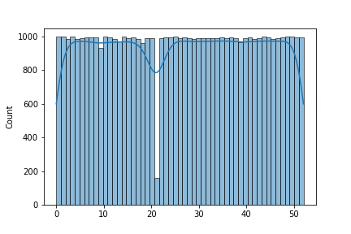
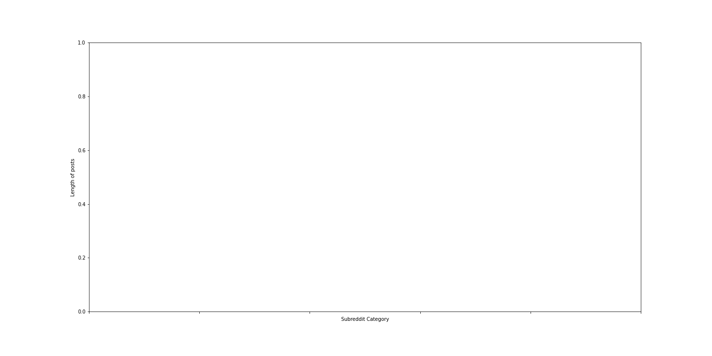

Whenever a user submit a post to Reddit, The poster is required to choose a subreddit category. A subreddit is topic/interest specific link aggregation pages with posts related to that topic. Reddit provides a default list of popular subreddits for the user to submit the post to. If none of those subreddits are appropriate, the user needs to search for a subreddit that is more relevant to the post. In this post we discuss how to use ML models in conjunction with NLP techniques to generate a list of subreddit recommendations based the post content. More specifically, the input is a text as a string or multiple texts in an iterable format such as ndarray or list, and return value is a list of recommended Subreddit categories from a list of pre-selected categories that the model has been trained on.

### Scraping Reddit data
In order to train any model first we need to collect the training and validation data. As its name suggests [PRAW](https://praw.readthedocs.io) is a Python wrapper for the Reddit API, which enables to scrape data for subreddits. For package management and reproducibility we use conda environment. 
PRAW can be installed using conda-forge channel:
```
conda install -c conda-forge praw
```
Here a python file connects to PRAW API and pulls information from 1000 posts in each of 53 selected subreddit categories. The pulled information includes: `subreddit name`, `subreddit id`, `title`, and `post body`. The pulled information are stored in a local sql database.
The created database contains 51610 rows and 4 columns. 
```
import sqlite3
conn = sqlite3.connect('subreddit_db.sqlite3')
c = conn.cursor()
c.execute('''create table submission_table (
               subreddit_name text,
               subreddit_id text,
               title text,
               text text
             )
             ''')
```
Before `praw` can be used to scrape data we need to authenticate the user credentials. For this we need to create a Reddit instance and provide it with a client_id , client_secret and a user_agent.
```
import praw
import os
from dotenv import load_dotenv

# instantiate praw
load_dotenv()
reddit = praw.Reddit(client_id=os.getenv('CLIENT_ID'),
                     client_secret=os.getenv('CLIENT_SECRET'),
                     user_agent='veggiecode')
```
Since we pull data for specific subreddit categories, the model recommendation would be limited to those selected subreddit categories that the model is trained on.
```
import time

sleep_min = 2
sleep_max = 5
start_time = time.time()

# sub_list is the list of pre selected categories
for name in sub_list:
    subreddit = reddit.subreddit(name)
    records = []
    for submission in subreddit.top(limit=1000):
        records.append([subreddit.display_name, subreddit.id, submission.title, submission.selftext])
    print(records[0])
    c.executemany('''insert into submission_table
                  (subreddit_name, subreddit_id, title, text)
                  values (?, ?, ?, ?)
                  ''', records)
    conn.commit()
    subreddit_count += 1
    if subreddit_count % 5 == 0:
        time.sleep(np.random.uniform(sleep_min, sleep_max))


c.close()
conn.close()
```
### Data Cleaning:
For cleaning data first import the stored data into a notebook.
```
data = pd.read_sql_query("select * from submission_table order by random() limit 100000;", conn)
# subreddit_subs: is the number of subscriber in the subreddit category
print(data.shape)
(51610, 4)
```
Here is a sample of the data:

<table border="1" class="dataframe" style="overflow-x: scroll;display: block; max-height: 300px;"><thead><tr style="text-align: right;"><th></th><th>subreddit_name</th><th>subreddit_id</th><th>title</th><th>text</th></tr></thead><tbody><tr><th>0</th><td>literature</td><td>2qhps</td><td>James Franco's poems: hard to forgive</td><td></td></tr><tr><th>1</th><td>technology</td><td>2qh16</td><td>Predator Drone Spotted in Minneapolis During George Floyd Protests</td><td></td></tr><tr><th>2</th><td>DIY</td><td>2qh7d</td><td>I restored a $5 Kitchen Aid mixer I found at the thrift store</td><td></td></tr><tr><th>3</th><td>news</td><td>2qh3l</td><td>Alabama just passed a near-total abortion ban with no exceptions for rape or incest</td><td></td></tr><tr><th>4</th><td>Parenting</td><td>2qhn3</td><td>I thought my 6 year old was doing one of his math activities on the tablet, but nah</td><td>My 6 year old has a bunch of new apps and activities that his teacher sent us to put on his tablet. He's been occasionally asking me, from the other room, the answers to different math problems, like what's 12+7 or what's 22-8.  I'm like sweet he's doing his math! Nope. He's trying to bypass the parental locks on kids YouTube so he can watch shit that is blocked. He keeps exiting out and going back in which is I assume why he had to ask multiple times.</td></tr></tbody></table>

The database contains 51610 rows and 4 columns.
```
 #   Column          Non-Null Count  Dtype 
---  ------          --------------  ----- 
 0   subreddit_name  51610 non-null  object
 1   subreddit_id    51610 non-null  object
 2   title           51610 non-null  object
 3   text            51610 non-null  object
 ```
Let's check the unique categories in our collected data:
```
 subreddit_names = data['subreddit_name'].unique()
len(subreddit_names), subreddit_names
 ```
 Our created dataset consists of 53 categories.
 ```
 (53,
 array(['literature', 'technology', 'DIY', 'news', 'Parenting', 'cars',
        'WTF', 'MachineLearning', 'socialskills', 'Art', 'biology',
        'politics', 'personalfinance', 'sports', 'worldpolitics',
        'Documentaries', 'food', 'LifeProTips', 'movies',
        'TwoXChromosomes', 'nottheonion', 'mildlyinteresting', 'Health',
        'AskReddit', 'history', 'Cooking', 'Music', 'Fitness',
        'GetMotivated', 'Design', 'gaming', 'entertainment', 'television',
        'books', 'JusticeServed', 'math', 'investing', 'science',
        'camping', 'Coronavirus', 'PublicFreakout', 'travel', 'funny',
        'HomeImprovement', 'scifi', 'worldnews', 'AdviceAnimals',
        'programming', 'gadgets', 'conspiracy', 'space', 'Showerthoughts',
        'announcements'], dtype=object))
 ```
 Let's look at number of posts per subreddit category.
 ```
sns.histplot(
    x=data['subreddit_name'].astype('category').cat.codes, 
    bins=data['subreddit_id'].nunique(),
    kde=True)
 ```
 

Ideally we would use the entire dataset for the training. However for practical reasons that would substantially increase the size of the serialized model and complicate the deployment of the model. For this reason we are going to use a smaller subset of the dataset for training. 
The above graph shows that we have about 1000 posts per subreddit category as expected. However some the posts might have small amount of text that would not be sufficient for our natural language processing. 
Hence we choose the posts that have enough text content. Later on we are going to choose only the categories (features) that  have enough number of posts (instances) to train on.

To get an idea of the posts lengths, let's plot the average length of posts per subreddit category.
```
post_mean = data1.groupby(by='subreddit_name').apply(lambda x: x['text_length'].mean())
plt.figure(figsize=(8,4))
ax = sns.barplot(x=post_mean.index, y=post_mean.values)
ax.set(xlabel='Subreddit Category', ylabel='Average length of posts')
ax.set(xticklabels=[])
plt.show()
```


The above graph shows the average length of posts is not the same in different subreddit categories.
After filtering the low count subreddit categories we end up with 44 categories and 4400 posts. We take a note that in a production setup we need more training data to achieve a reliable results.

### Machine Learning Model
The model is supposed to recieve a text as a post content and classify it to one of the 44 subreddit categories. We consider a random classifier as baseline with an accuracy of 1/44, which is very low. To build our model we use a two stage pipeline. The first stage encodes the text into a numerical format and the the second stage classifies the text into one of the target labels.

#### spaCy Embedding
For the first stage of the pipeline we are going to use [spaCy](https://spacy.io) embedding. spaCy is an open-source software library for natural language processing. spaCy performs two major tasks for us, tokenizing and vectorizing. The `tokenizer` is a component that segments texts into tokens. In spaCy, this is rule-based and not trainable. It looks at whitespace and punctuation to determine which are the unique tokens in a sentence. The `tok2vec` layer is a machine learning component that learns how to produce context-based vectors for tokens. It does this by looking at lexical attributes of the token. The tok2vec component is already pretrained from external vectors data. The external vectors data already embeds some "meaning" or "similarity" of the tokens. 
```
import spacy
from spacy.tokenizer import Tokenizer
from spacy.lang.en.stop_words import STOP_WORDS
#Create the nlp object
nlp = spacy.load("en_core_web_md")
```
the `en_core_web_md` model has 685k keys, 20k unique vectors of 300 dimensions. We can define a function to embed the text and use it in a Scikit-learn `FunctionTransformer` as the first stage of the pipeline.
```
# Spacy embedding
def get_word_vectors(docs):
    """
    docs: can be string or a list of strings
    """
    if isinstance(docs, str):
      docs = [docs]
    return np.array([nlp(str(doc)).vector for doc in docs])

# Instantiate functiontransformer of the spacy vectorizer
embed = FunctionTransformer(get_word_vectors)
```
The pipeline is defined as:
```
pipe = Pipeline([
                 ('emb', embed), 
                 ('clf', clfi)])
```
clfi is an instance of a classifier. For this work we try different classifers from `Scikit-learn` library, namely, `KNeighborsClassifier()`, `GradientBoostingClassifier()`, and `XGBClassifier()` from `xgboost` library.

#### Hyperparameter Tuning
We are going to benefit from hyperparameter tuning to optimize our model. For this purpose we use `RandomizedSearchCV()`. This would also perform the cross validation that is helpful considering the fact that our training data is rather small. Nevertheless we split the data into train and test to keep some data away to evaluate the model overfit.
```
est = {}
for key, value in est_dict.items():
  clfi = value[0]
  # print(clfi, type(clfi))
  param_dist = value[1]
  
  # spacy embedding can be taken out of the pipeline to save time in hyperparameter tunning
  pipe = Pipeline([
                   ('emb', embed), 
                   ('clf', clfi)])
  
  est["{0}_est".format(key)] = RandomizedSearchCV(pipe, 
                                                  param_distributions=param_dist, 
                                                  n_iter=4, cv=2, verbose=1)
  
  print('\n', 5*'*',' fitting',key, ' estimator..... ',5*'*')
  est["{0}_est".format(key)].fit(X_train.values, y_train.values)
  print("best params: ",est["{0}_est".format(key)].best_params_)
  print("best score: ",est["{0}_est".format(key)].best_score_)
  print("Test score: ",est["{0}_est".format(key)].score(X_test.values, y_test.values))
```
After model fit, `KNeighborsClassifier`, `GradientBoostingClassifier`, and `XGBClassifier` produce the test accuracy of 0.34, 0.51, and 0.53, respectively. Compared to our 0.02 baseline accuracy this is a huge leap forward.
It is noteworthy that here in the hyperparameter tuning for every parameter set we are repeating the embedding process. Changing the hyperparameters should not affect the embedding. This is obviousely adds to the training time and to speed up the training we could have embed the training set beforehand. On the other side for our small training dataset this is not a showstopper and it is only done once. Additionally it streamlines the later use of the trained model as we could simply feed the string text and let the trained model embed it internally. Otherwise we would have needed to preprocess any query and embed it separately before feeding it to the trained model. 


Despite having the embedding stage as a part of the trained model we can still access the specific internal methods of the classifier. For example let's take the pipeline model that includes `KNeighborsClassifier`. Let's say we want to give a random text and find the neighboring samples from the training set. First we define a function to preprocess the input text, which simply means embeding the text here.
```
# Convert input string to embedded vector
def preprocess(query, vectorize):
  """
  Vectorizes the 'query' string by spacy pretrained model (nlp). 
  the return value serves as a query to the prediction model
  """
  return vectorize(query).reshape(1,-1)
```
A `neighbors` function would recieve an embeded input and calls the `kneighbors()` method of the `KNeighborsClassifier()` to calculate the neighboring samples from the train set.
```
# Accessing the neighbors() method of the KNClassifier of the trained pipeline estimator 
def neighbors(clf, input, X_train, y_train):
  """
  input: a string type text or vectorized array or an iterable data type
  return: Dataframe of nearest neighbors and their subreddit categories
  """
  results = clf.kneighbors(input)
  neighbors_idx, neighbors_dist = results[1][0], results[0][0]
  neighbors_df = pd.concat([X_train.iloc[neighbors_idx], y_train.iloc[neighbors_idx]], axis=1)
  return neighbors_df
```
Now for a given text:
```
query = """Does this seem too advanced for first month of kindergarten?
Usually my husband is sitting with my son (working from home, but present) 
during my son's Zoom class but yesterday I did. I was really surprised by 
what the teacher was asking of the kids. My son's teacher wanted the students 
to write stories live during the zoom meeting. She expected them to write full 
sentences with words like "suddenly." She told them if they can't spell the 
words to "sound it out." She kept reminding them to use connecting words to 
transition between topics. The example story she wrote was about 5-6 sentences. 
It was about going to the playground and waiting for her turn on the swings. 
I was pretty surprised because the kids are still learning the alphabet. 
how would they be able to write sentences for before learning letters? Before we 
started school, the principal specifically told families at an info night, 
"Don't worry if your kid doesn't know the alphabet, we'll reach them!" 
So I don't think the teacher has expectations that the kids could already write."""
```
We preprocess the input text and call the neighbors function to get the minimum distance samples from teh train set.
```
vect = preprocess(query, get_word_vectors)
kneighbors = neighbors(est_best['knc']['clf'], vect, X_train, y_train)
kneighbors
```
The neighboring samples from the train set are:

<table border="1" class="dataframe" style="overflow-x: scroll;display: block; max-height: 300px;"><thead><tr style="text-align: right;"><th></th><th>joint_text</th><th>subreddit_name</th></tr></thead><tbody><tr><th>49913</th><td style="height:100px; overflow:hidden;">lpt at the beginning of every semester make a dedicated folder for your class where you download and save all documents especially the syllabus teachers try to get sneaky sometimes taught this to my sister last year she just came to me and told me about how her ap english teacher tried to pull a fast one on the entire class x200b i've had it happen to me before as well in my bachelors x200b teacher changes the syllabus to either add new rules or claim there was leniancy options that students didn't take advantage of most of the time it's harmless but sometimes it's catastrophic to people's grades x200b in my case teacher tried to act like there was a requirement people weren't meeting for their reports which was not in the original syllabus upload x200b in my sister's case </td><td>LifeProTips</td></tr><tr><th>28021</th><td>the letter charles iii of spain wrote to his parents telling them about his wedding night in 1738 charles iii of spain https en wikipedia org wiki charles_iii_of_spain married princess maria amalia of saxony https en wikipedia org wiki maria_amalia_of_saxony daughter of polish king augustus iii and an educated cultured woman who gave birth to 13 children eight of whom reached adulthood the marriage responded to political'needs' but the couple enjoyed a romantic and harmonious union after the death of his stepbrother ferdinand vi with no descendants charles was crowned king of spain as charles iii in 1759 a year later his wife died and he never remarried charles iii remained a widower for the rest of his life without ever having a mistress in 22 years of marriage this is the first serious upset i've had from amalia the pain that this irreparable loss causes me is equal to the tender love i professed for her this is the letter that charles iii wrote to </td><td>history</td></tr><tr><th>46137</th><td>i hate that i'm bad at math is the end of the conversation if you were with someone who could barely read the words on a menu at a restaurant and they responded casually with oh i'm just bad a reading that would be unacceptable you would be concerned about their education they don't have to love reading or be able to make out sloppy cursive writing but you'd expect them to have a certain level of competency in reading so that they do everyday tasks in middle school and high school i did horribly in math but my excuse was always i'm just bad at math not like kevin who's naturally gifted and pretty much everyone just let me get away with it even my own teachers didn't push me very hard it took me a long time to realize kevin was good at math because he practiced problems everyday for the same amount of time i read </td><td>math</td></tr></tbody></table>

Now if we want to predict that which subreddit category this text belongs to:
```
def prediction(model, input, n):
  """
  input: text string or iterable dtype (list, np.array, vectorized array)as input
  model: trained model with predict_proba method
  returns a pandas series containing the recommended subreddit names
  """
  # Return whether an object is an instance of a class 
  if isinstance(input, str):
    input = [input]
  # probability of each class
  proba = model.predict_proba(input)
  # print(proba.shape)

  # index of the highest probable classes in descending order
  # i[0] is index and i[1] is probability
  index_max = [i[0] for i in sorted(enumerate(proba[0]), key=lambda x:x[1])][::-1]
  
  # Alternative way
  # index_max = proba[0].argsort()[::-1]

  # get the most probable class names
  name = pd.Series(model.classes_[index_max][:n])
  return pd.Series(data= name.to_list(), index = index_max[:n])
```
neighbors() returns the subreddit category of the nearest neighbors to the input query among the inputs in X_train. Neigbhbors could be repeatedly from the same class. This is different from prediction() function which predicts the most probable subreddit categories that the query belongs to.
```
preds = prediction(est_best['knc']['clf'], vect, 10)
preds
```
The predicted subreddit categories are:
```
13          Parenting
28               math
25            history
36       socialskills
19              books
16    TwoXChromosomes
10        LifeProTips
43      worldpolitics
42          worldnews
41             travel
```
We get the same results if we call the prediction function on pipeline estimator and pass string query instead of embedding.
```
prediction(est_best['knc'], query, 10)
```
```
13          Parenting
28               math
25            history
36       socialskills
19              books
16    TwoXChromosomes
10        LifeProTips
43      worldpolitics
42          worldnews
41             travel
```
Next we'll show how to serialize the model for deployment.
### Model Serialization
There are a few ways to put trained machine learning (ML) models into production. The most common method is to serialize the model using some particular format after training, and deserialize that model in the production environment. One way of serializing an object is to write Python objects to a bytestream. This can be done with pickle a built-in python module. One can take this file and load it back into a separate Python interpreter at a later date, recovering the objects from the previous session. It's important to note that pickled files are tightly coupled with the environment in which they were created.
```
import pickle
est_pickle = {}
loaded_pickle ={}

for key in est_dict:
    print("key:", key)
    with open(f'{key}_pkl', 'wb') as est_pickle[key]:
        pickle.dump(est_best[key], est_pickle[key])

    loaded_pickle[key] = pickle.load(open(f'{key}_pkl', 'rb'))
```
Now we can try the same sample input and check if we get the same results with pickled model.
```
prediction(loaded_pickle['knc'], query, 10)
```
```
13          Parenting
28               math
25            history
36       socialskills
19              books
16    TwoXChromosomes
10        LifeProTips
43      worldpolitics
42          worldnews
41             travel
```
Results matches the previous prediction as expected.

### Conclusion
In this work we built a machine learning model using NLP techniques and optimized it with scikit-learn RandomSearchCV() to predict a subreddit category for a given post. We used a python wrapper for Reddit API, PRAW, to create a database of subreddit posts from the categories of interest. After cleaning the data, we fit and tuned three different models and compared their performances. Next We took an article as a sample input and applied KNN model to get similar articles from the training set. We also used the sample input article to predict top subreddit categories that are related to the article. The serialized model can be deployed to a datascience API in order to build a full stack application.

### links
- [Github repo](https://github.com/skhabiri/SubReddit-Recommender)
- [PRAW](https://praw.readthedocs.io)
- [SciKit-Learn](https://scikit-learn.org/stable/getting_started.html)
- [spaCy](https://spacy.io/)
